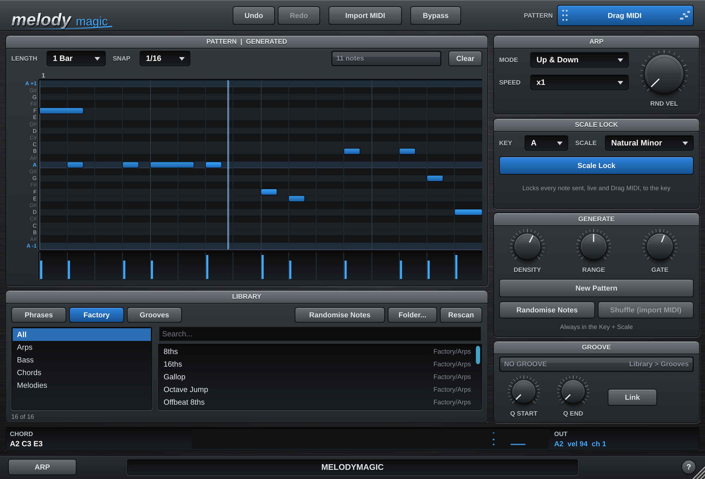

# MelodyMagic

MelodyMagic is a pattern arpeggiator for Windows (VST3, JUCE 8). Hold a key or a chord and it plays a pattern with it:

* **One key** plays the pattern as a melody in that key.
* **A chord** is arpeggiated (Up, Down, Up & Down or Down & Up), and the pattern sets the rhythm.

Everything it generates is locked to your key and scale. **Drag MIDI** drops the result straight onto your DAW's timeline.

It shares its look with **Virus Delay** and **ArpSampler**: the same palette, knobs, panels and LCDs, all drawn as vectors.



## Installing

Every push to `main` builds the plugin on GitHub Actions and runs the unit tests and pluginval (strictness 10). It then commits a zipped build to the **`builds-windows`** branch.

1. Download `MelodyMagic-VST3-Windows-x64.zip` from that branch, or from the run's artifacts.
2. Unzip `MelodyMagic.vst3` into `C:\Program Files\Common Files\VST3\`.
3. Rescan plugins in your DAW.

MelodyMagic takes MIDI in and sends MIDI out; it makes no sound itself. It loads as an instrument, because that is the slot DAWs let send MIDI on to another track.

* **Ableton Live:** set the synth track's *MIDI From* to the MelodyMagic track.
* **FL Studio:** set a MIDI output port in MelodyMagic's wrapper, and the same port on the synth.
* **Any DAW:** you can skip the routing and use **Drag MIDI**.

## Using it

**Pattern (top left).** The pattern is a small piano roll. The rows are shown as notes of the Scale Lock **Key**, as if you were holding the key's root; holding another key moves the whole pattern with it.

| Action | Result |
|---|---|
| Click empty space | add a note (drag to set its length) |
| Drag a note | move it |
| Drag a note's right edge | change its length |
| Alt while dragging | no snap |
| **Mouse wheel over a note** | up / down a semitone (with Scale Lock on, to the next note of the scale) |
| Right-click or double-click a note | delete it |
| Drag in the lower strip | set velocities |

**Length** (1, 2, 4 or 8 bars), **Snap**, **Clear**, **Undo** and **Redo** are around the pattern.

**Arp.**

* **Mode** sets the order the held keys are played in: Up, Down, Up & Down, Down & Up. Each pattern note plays the next key in that order.
* **Speed** runs from x1/4 to x4 of the host tempo.
* **Rnd Vel** adds a random ± velocity.

While the DAW plays, the pattern follows the song position. While it is stopped, the pattern starts when you press a key.

**Scale Lock.** **Key** and **Scale** use ArpSampler's 16 scales, plus Persian, Chromatic and Custom. For Custom, click the 12 note buttons to build the scale; it ignores the key. With **Scale Lock** on, every note sent, live or through Drag MIDI, moves to the nearest note of the scale.

**Generate.** Everything here is always in the Key and Scale:

* **New Pattern** makes a new rhythm with new notes. **Density** sets how many 1/16 steps play, **Range** how far notes go from the root (± semitones), and **Gate** the note length.
* **Randomise Notes** keeps the rhythm and picks new notes. The same button is in the Library, for the pattern you've loaded there.
* **Shuffle File Notes** works after **Import MIDI**. It keeps the rhythm and uses exactly the notes from the MIDI file, in new places.

**Import MIDI.** Use the top-bar button or drop a `.mid` file on the pattern. The file's notes and rhythm become the pattern, up to 8 bars from the bar of its first note. Holding the key's root plays the file's notes back as they are.

**Library.** It lists the **Factory** patterns, your **Phrases** and your **Grooves**; click an entry to load it.

* **Folder...** picks the library folder. The default is `Documents\MelodyMagic\Library`, and it can hold `nora_fas_library.json` / `nora_qas_library.json`, or `.fas` / `.qas` files.
* These library files are not in this repository: their pack asks that they not be redistributed.

**Groove.** Pick a groove in **Library > Grooves**. **Q Start** and **Q End** pull note starts and ends onto it; **Link** uses one strength for both.

**Drag MIDI.** Drag the blue grip onto a DAW track. It renders exactly what you hear, over the last chord you played (or the key's root if you haven't played yet). The clip is at least 4 bars long. Right-click the grip to save the `.mid` file instead.

**Knobs** move in whole steps of 1, by drag or mouse wheel; double-click resets a knob. The window resizes from 60 % to 200 % from the corner.

## Building

You need CMake 3.22 or newer and Visual Studio 2022. JUCE 8.0.4 and Catch2 are downloaded automatically.

```bash
cmake -B build -G "Visual Studio 17 2022" -A x64
```

```bash
cmake --build build --config Release --target MelodyMagic_VST3 MelodyMagicTests
```

```bash
build\Release\MelodyMagicTests.exe
```

The plugin is written to `build/MelodyMagic_artefacts/Release/VST3/MelodyMagic.vst3`. The musical code in `core/` has no JUCE dependency, so the tests also build on Linux and macOS (`-DMELODYMAGIC_BUILD_PLUGIN=OFF`).

```
core/            pattern model, arpeggiator, generate / randomise / shuffle, MIDI import,
                 scales, groove quantize, library (.fas / .qas / JSON), MIDI files
tests/           Catch2 unit tests
plugin/Source/   JUCE plugin: processor, editor, pattern grid, library, monitor, Drag MIDI
tools/           screenshot tool (docs/screenshot.png)
```
